# Module 5 - Lab 1 : Manage Datastores
{: .no_toc}

## Table of Contents
{: .no_toc}

  

    Expand to access the In-page navigation
  

  {: .text-delta }
1. TOC
{:toc}

## Objective(-s):

- Add the shared System datastore.
- Add the shared Image datastore.

{: .note}
> Please note that in this lab **NFS** is already configured and mounted across the environment, therefore you don't need to edit the /etc/fstab file, install nfs tools and mount it yourself. In the real-life scenario you will need to perform all the mentioned yourself in the automated or manual way!

{: .warning}
> Also it's worth mentioning that in this lab environment frontend serves as the NFS server, however in real-life scenario you will have a dedicated Storage system for this!

# Add the shared System datastore.

## 5.1.1

Navigate to **Storage -> Datastores**.

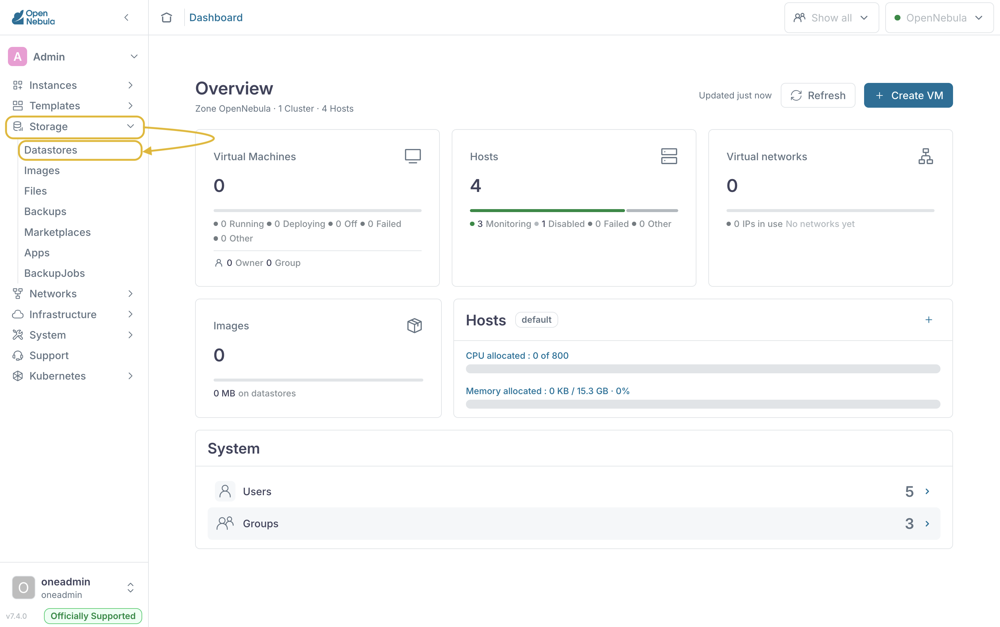

## 5.1.2

Press the **Create Datastore** button.

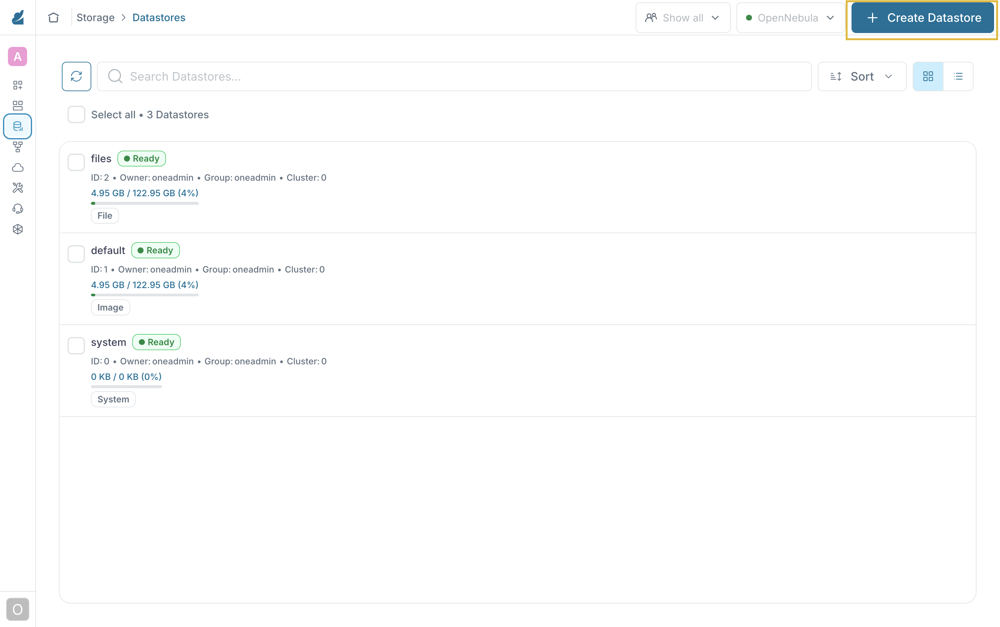

## 5.1.3

Let's create the System datastore first. 

Make sure to set the **Datastore type** to **SYSTEM** and the **Storage backend** value to **Filesystem - shared mode**. 

In this guide we will name it as **nfs-sys** while you can name it the way you wish.

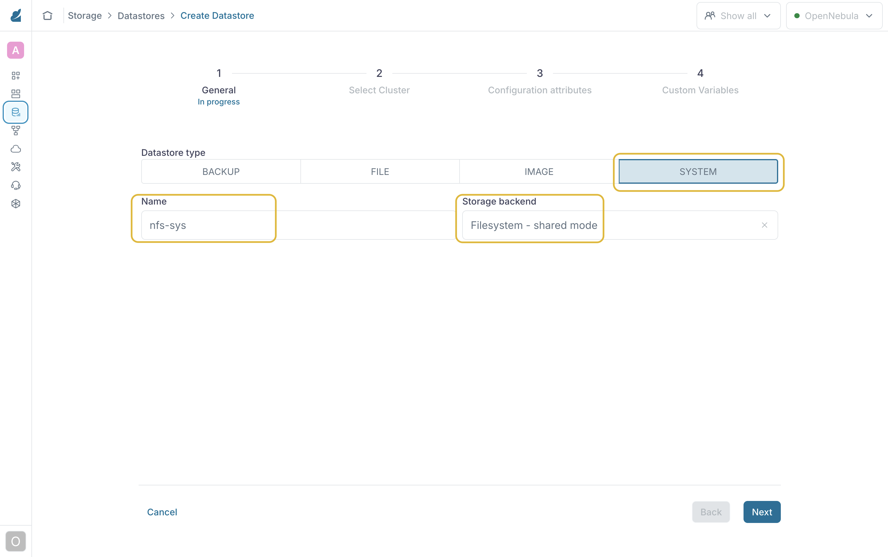

## 5.1.4

Select the **default** cluster and proceed to the next page.

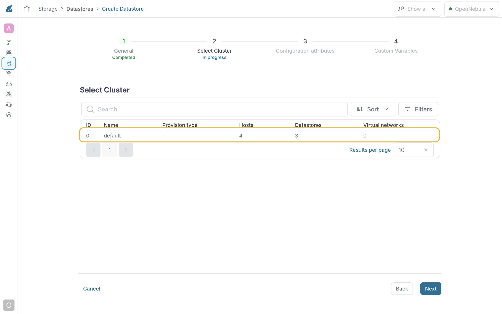

## 5.1.5

There's no need to adjust any of these settings at the moment so let's keep them on defaults and proceed to the next page.

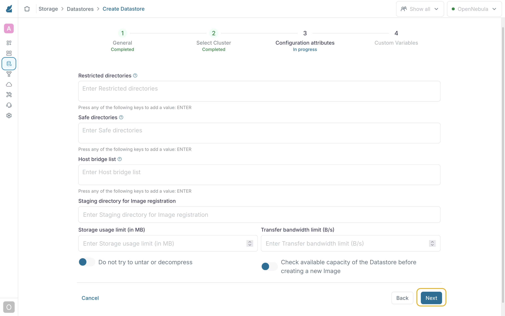

## 5.1.6

Leave the Custom Attributes page as is and finish the creation of a datastore.

## 5.1.7

Note that unlike the default system datastore - the shared one is showing the disk space metrics.

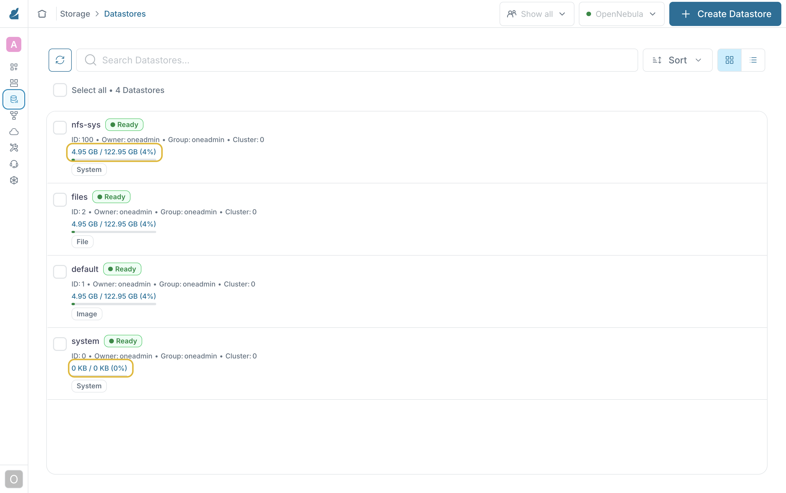

# Add the shared Image datastore.

## 5.1.8

Press the **Create Datastore** one again. 

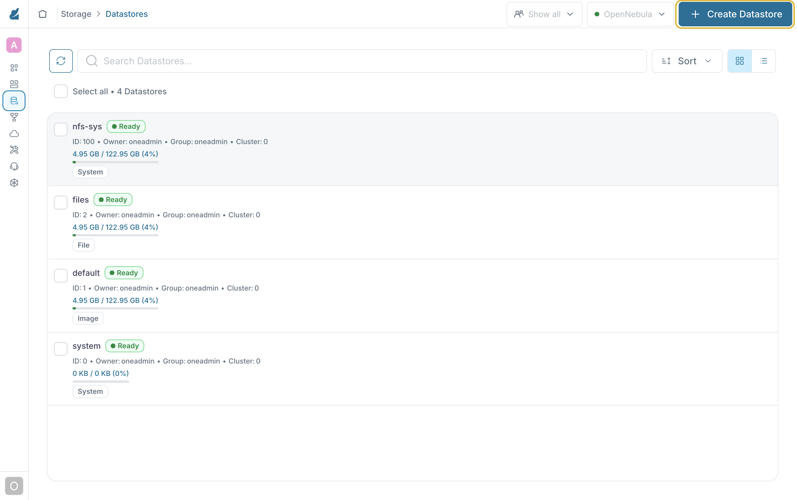

## 5.1.9

This time the **Datastore type** must be set to **IMAGE** while the backend still set to **Filesystem - shared mode**. 

Name can be set to the value you like. 

## 5.1.10 

Select the **default** cluster.

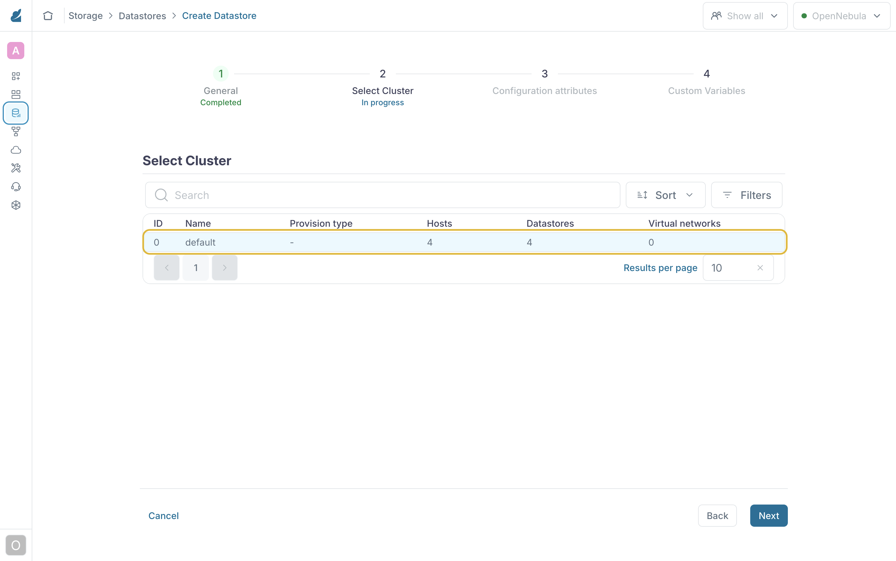

## 5.1.11

In the **Compatible system datastores** select the shared system datastore you've created before. 

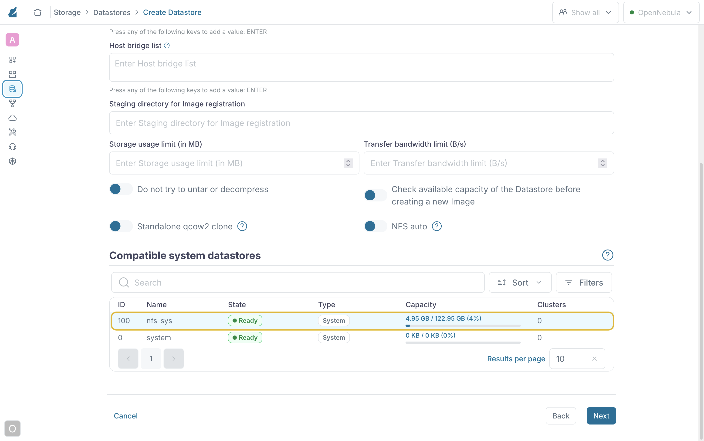

## 5.1.12

Finish the process.

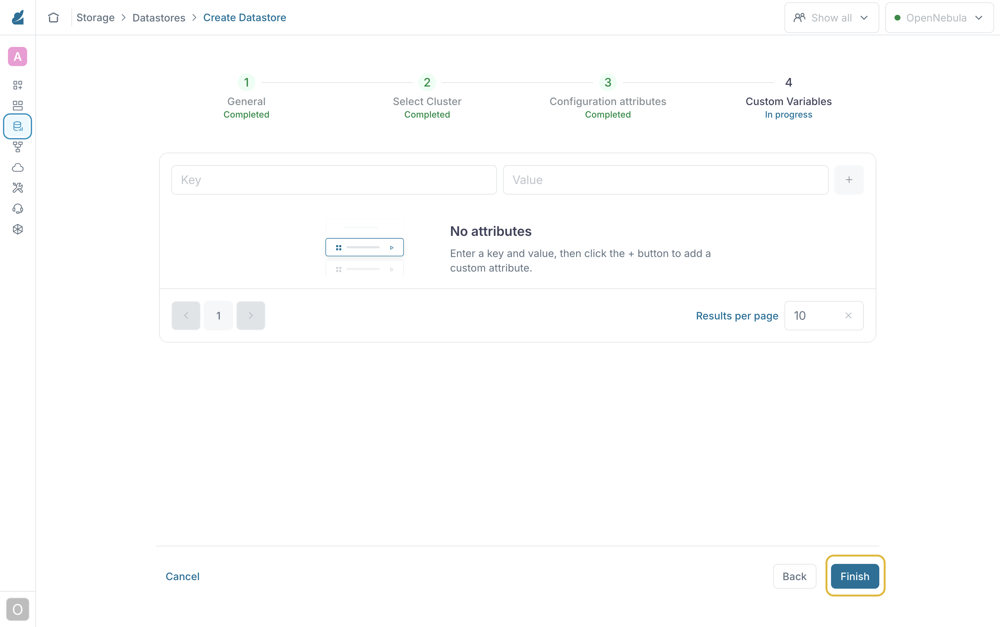

## 5.1.13

You must end up having two shared datastores. 

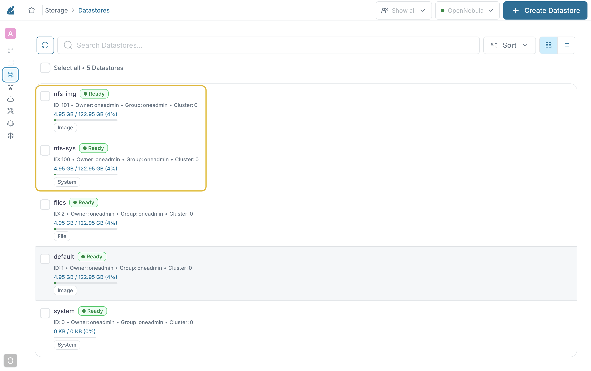

# Congratulations, you've completed the assignment!
{: .no_toc}