## Module 5 - Lab 3 : Image Management
{: .no_toc}

## Table of Contents
{: .no_toc}

  

    Expand to access the In-page navigation
  

  {: .text-delta }
1. TOC
{:toc}

    
## Objective(-s):
- Download an Image from the Marketplace.
- Import an Image from the URL.
- Change the Persitency of an Image.

# Download Images from the Marketplace.

## 5.3.1

Navigate to **Storage -> Apps** to access the list of available Images from all  Marketplaces. 

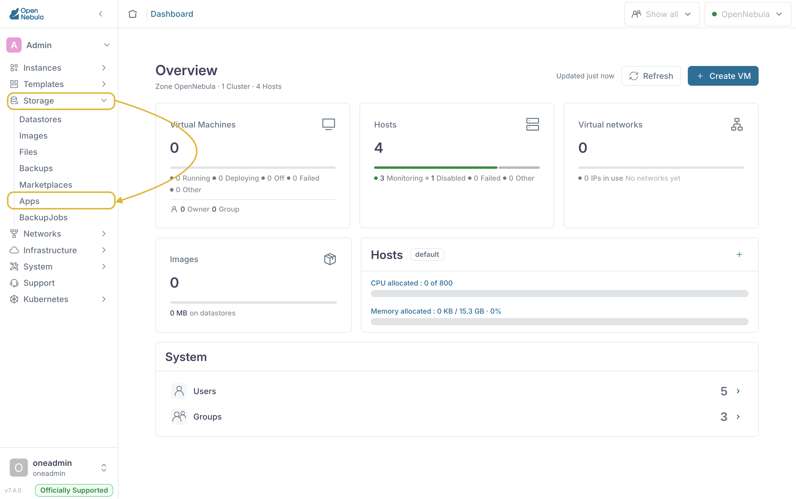
    
## 5.3.2

In the search bar enter **Alpine Linux 3.21** and locate the **Alpine Linux 3.21** image. 

Please select the **correct architecture**!

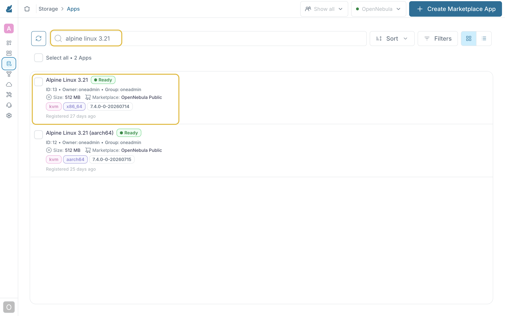
    
## 5.3.3

Press the Import button.

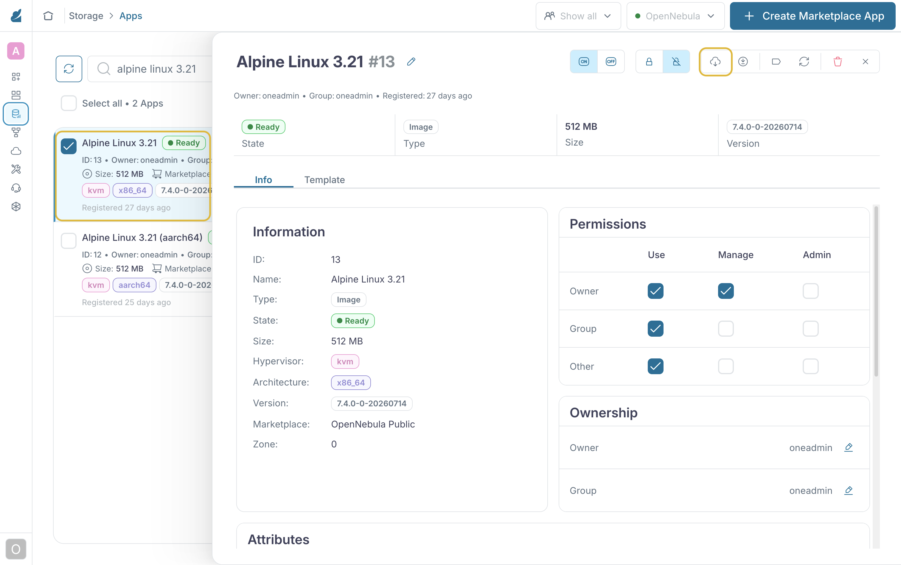
    
## 5.3.4

Keep the names as is, then proceed to the next page of the wizard.

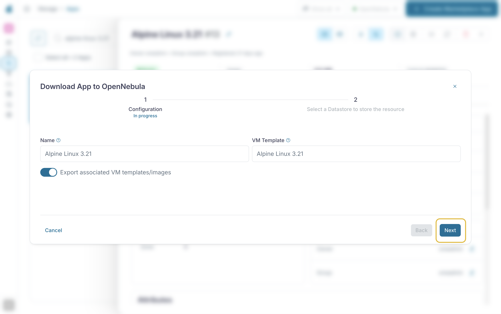
    
## 5.3.5

From the datastores select the **shared image datastore** one and press **Finish**.

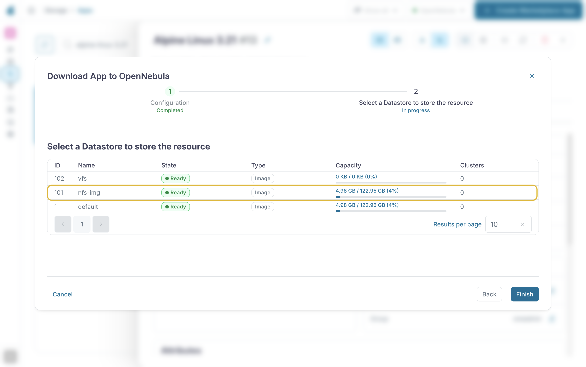

# Import an Image from the URL.
    
## 5.3.6

Navigate to the **Storage -> Images**.

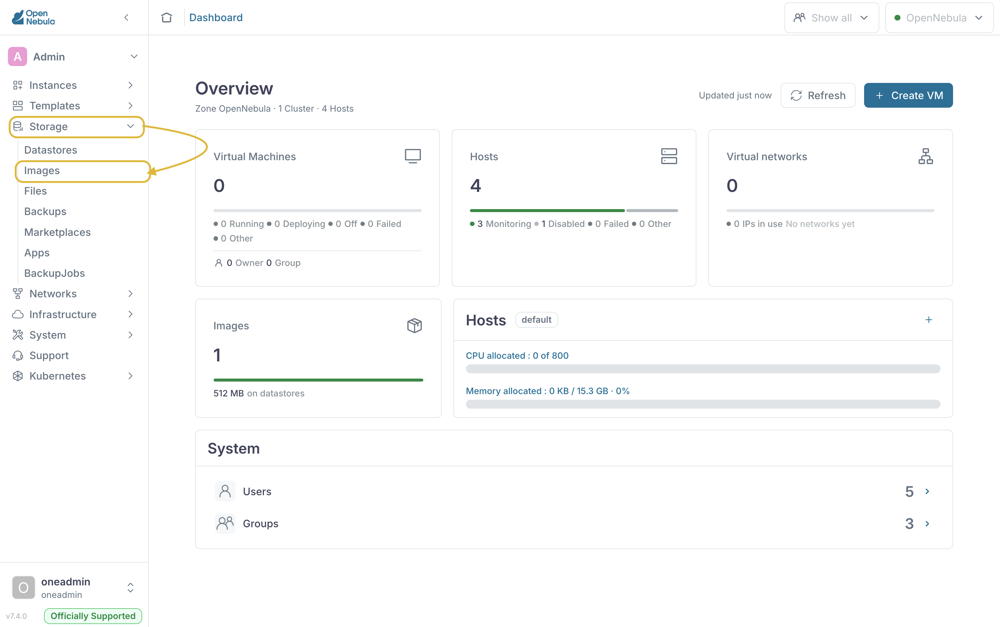
    
## 5.3.7

Press **Create Image** to start the wizard.

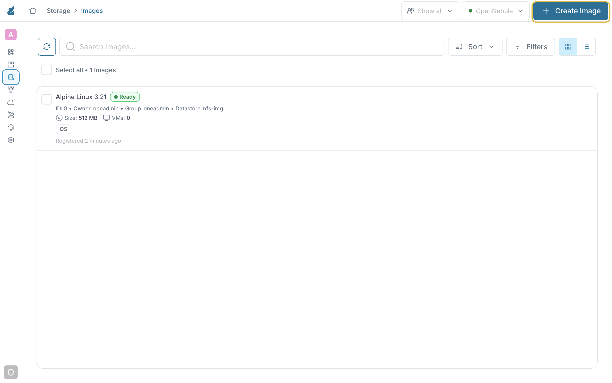
    
## 5.3.8

Name image as **Alpine Linux DB Server**.

Set the URL to the one provided by your instructor.

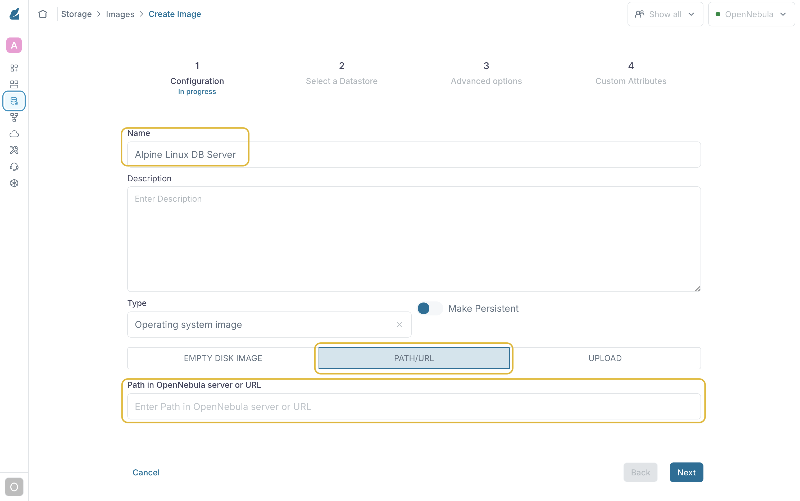
    
## 5.3.9

Select the shared image datastore and proceed to the next screen.

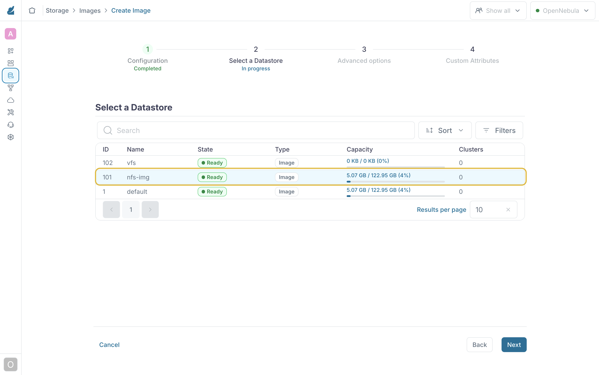

    
## 5.3.10

Set the **BUS** to **Virtio**.

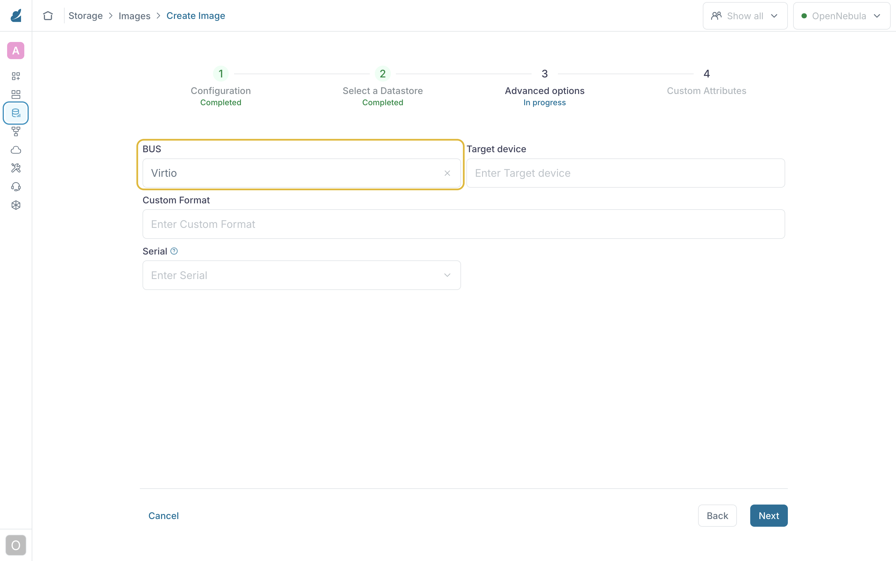

## 5.3.11

Keep the **Custom Atributes**  empty and press **Finish**

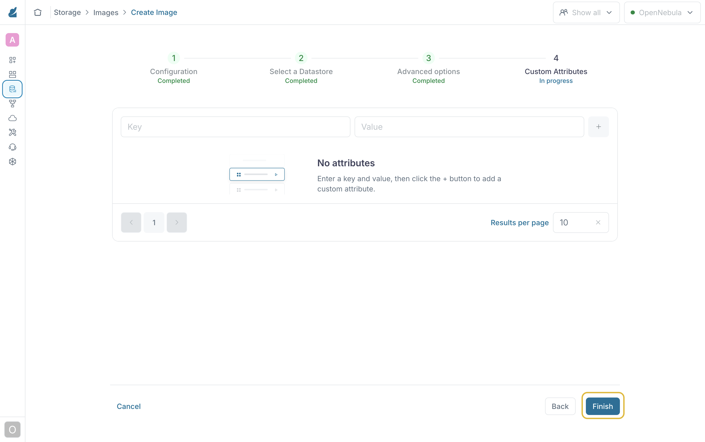

# Share Images and Change the Persitency of an Image.
    
## 5.3.12

Select the Alpine Linux 3.21 image

## 5.3.13

Then press the **Persistent** button.
    
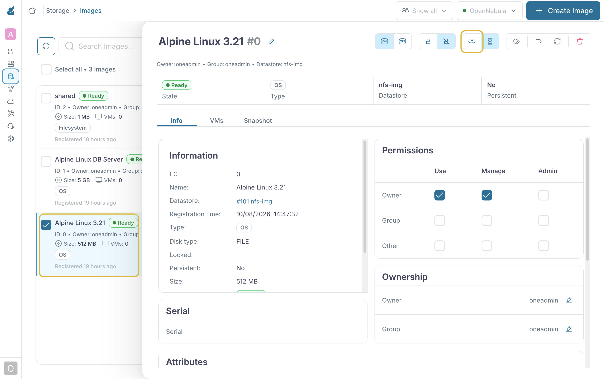

## 5.3.14

After that confirm the mode change.
    
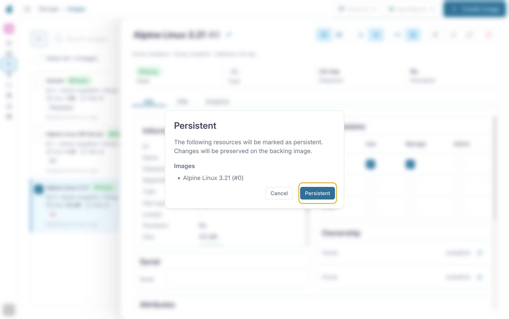

## 5.3.15

The image must become **Persistent**.

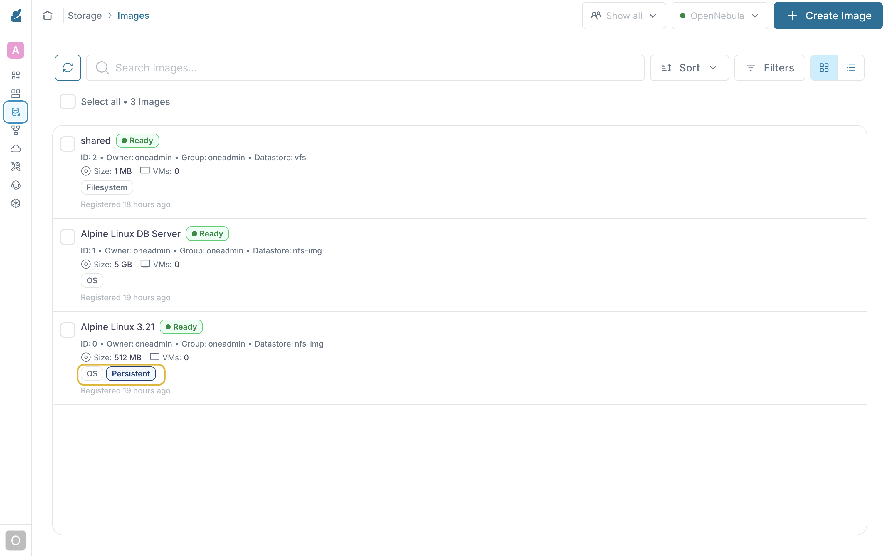

## 5.3.16 

{: .note}
> Now perform the same action, but with the second Alpine Linux-based Image. 
> You should end up with two images in the **Persistent** mode. 
    
# Congratulations, you've completed the assignment!
{: .no_toc}