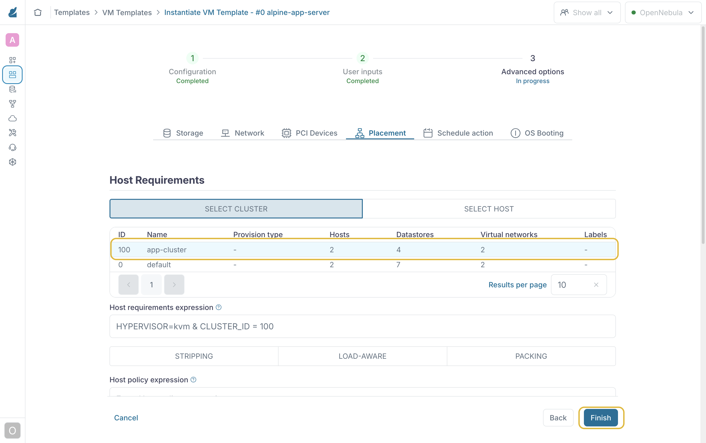
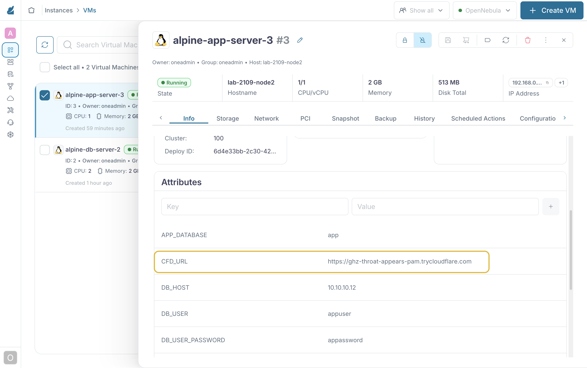
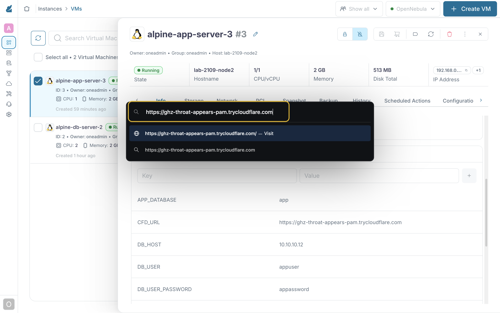
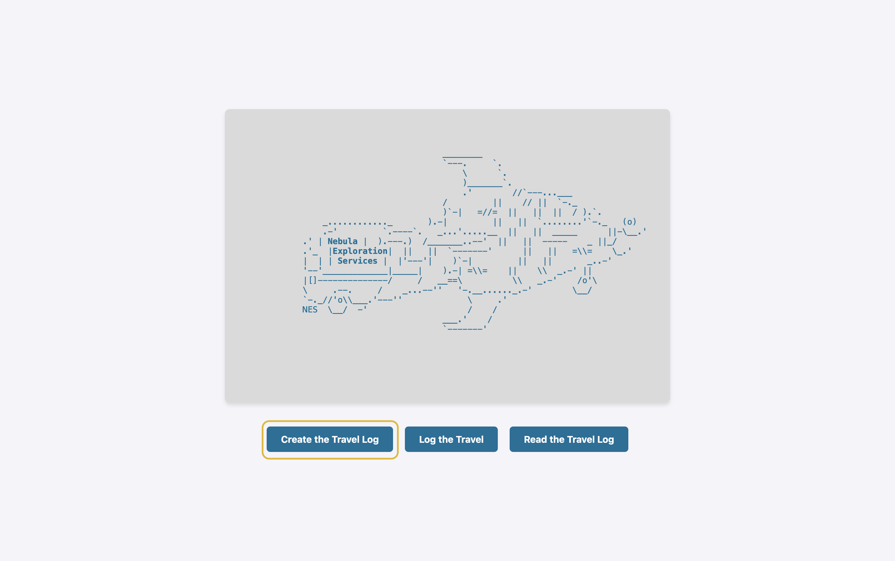
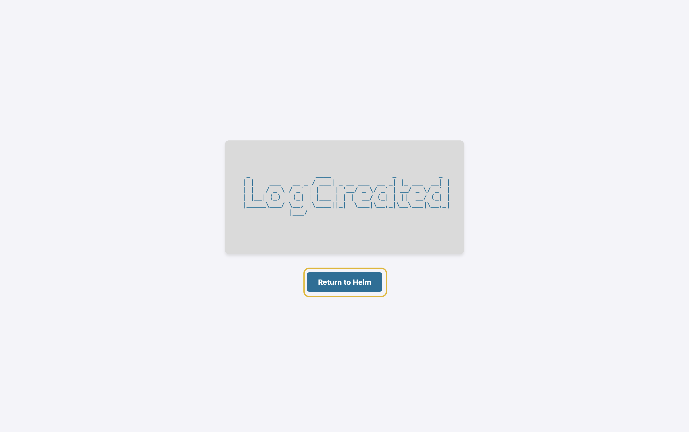
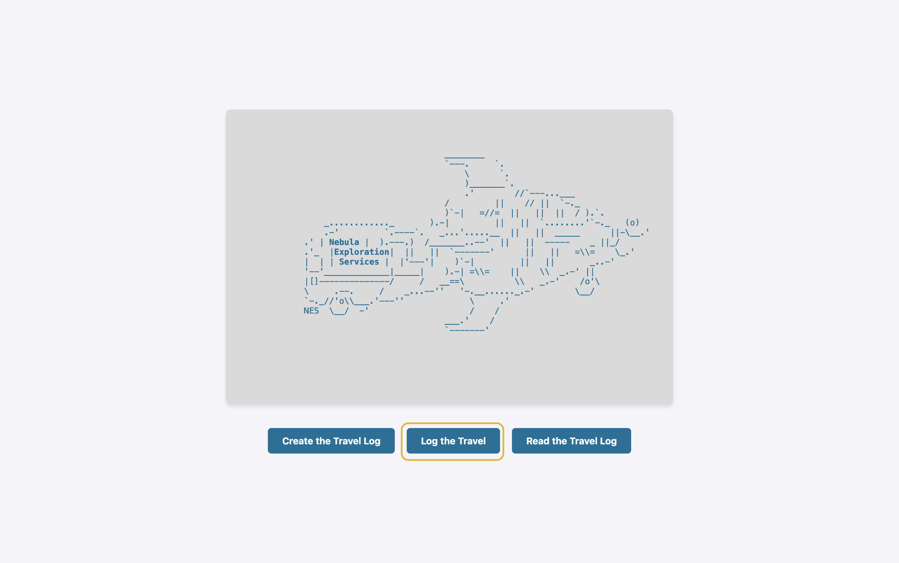
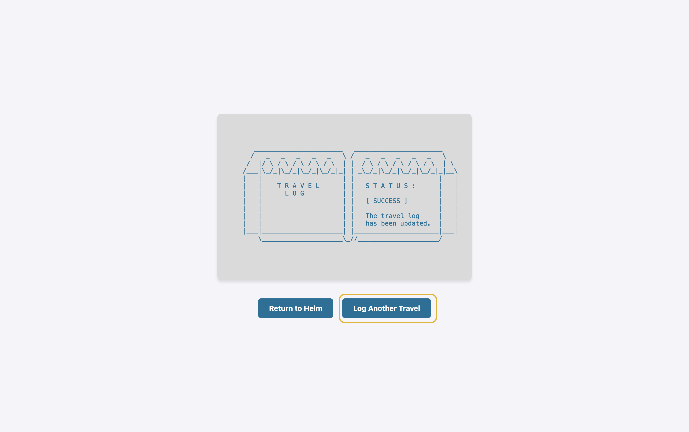
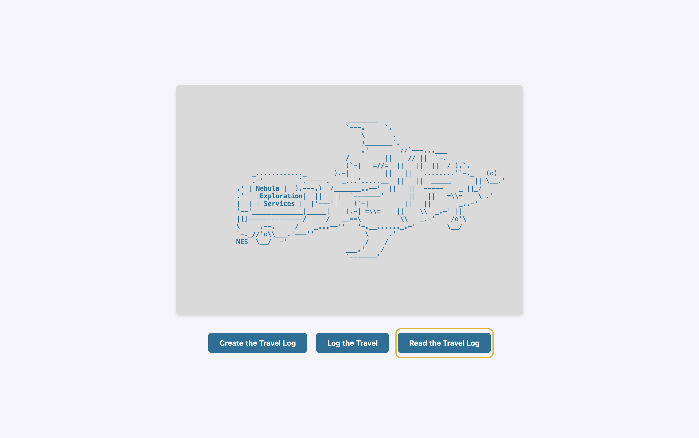
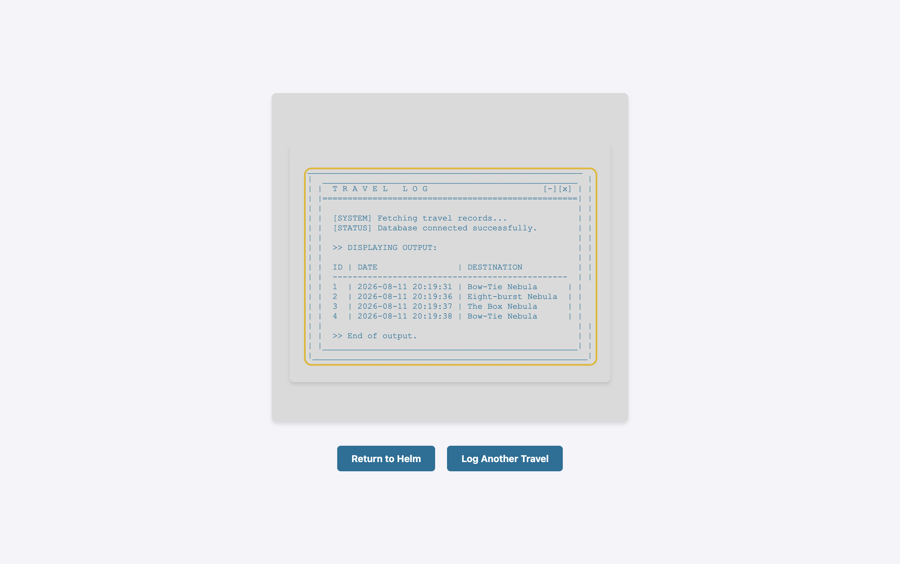

# Module 8 - Lab 3 : Deploy and Manage the VMs

## Table of Contents
{: .no_toc}

  

    Expand to access the In-page navigation
  

  {: .text-delta }
1. TOC
{:toc}

  

## Objective(-s):
- Deploy the Database VM.
- Deploy the Application VM.
- Verify the deployed Application.

# Deploy the Database VM.

## 8.3.1

Navigate to **Instances -> VMs**.

## 8.3.2

Press the **Create VM** button.

## 8.3.3

Select the **alpine-db-server** from the list.

## 8.3.4

Keep the **Configuration** screen as is and proceed ot the next page.

## 8.3.5

On the **User Inputs** page leave the input as is or enter the compatible timezone. For example - **Europe/Madrid**.

## 8.3.6

On the **User Inputs** page leave the input as is or enter the compatible timezone. For example - **Europe/Madrid**.

## 8.3.7

Wait until the VM is in the **Running** state and an IP address has been assigned. 

Copy the IP address - you will need it in the further steps. 

# Deploy the Application VM.

## 8.3.8

Back on the VMs page - press the **Create VM** button.

## 8.3.9

From the VM Template list select the **alpine-app-server** VM Template.

    
## 8.3.10

Keep the Configuration as is and proceed to **User inputs**.

    
## 8.3.11

Set the **DB_HOST** to the IP Address of the **alpine-db-server** VM you have extracted before.

Set the **DB_PASSWORD** to **appassword** and leave rest as is.

## 8.3.12

Go to the **Placement** tab and make sure to select the **app-cluster** cluster.

{: .note}
> It may take some time to start the VM + there's an internal sleep time to 60 seconds in the Start script. Return back in 3 to 5 minutes to proceed with the lab.
    
## 8.3.13

In the **Attributes** locate the **CFD_URL** attribute and copy the value.

# Verify the deployed Application.
  
## 8.3.14

Open the URL in the new tab.

    
## 8.3.15

Press the **Create the Travel Log** button.

   
## 8.3.16

{: .note}
> You **must get the success message, otherwise stop and debug the connectivity between your VMs**.

Press **Return to Helm**.

    
## 8.3.17

Press the middle button to create a record in the Log.

## 8.3.18

You must get the success message. 

Press the **Log Another Travel** button a few times to create more records.

Once ready - press the **Return to Helm** button. 

   
## 8.3.19

Lastly we must request the data!

Press **Read the Travel Log**.

					

## 8.3.20

Your data must be printed.

	
  
# Congratulations, you've completed the assignment!
{: .no_toc}