# Module 4 - Lab 1 : Image Management 
{: .no_toc}

## Table of Contents
{: .no_toc}

  

    Expand to access the In-page navigation
  

  {: .text-delta }
1. TOC
{:toc}

## Objective(-s):
- Import an Image from the Marketplace
- Change the Persistency setting of both Images

# Import an Image from the Marketplace

## 4.1.1

Navigate to **Storage -> Apps**.

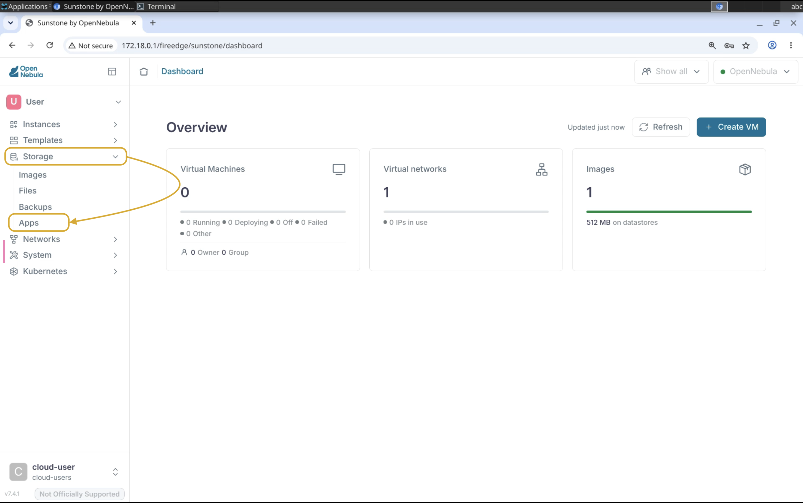

## 4.1.2

In the search bar enter **Ubuntu 24.04** and select the correct image from the list.

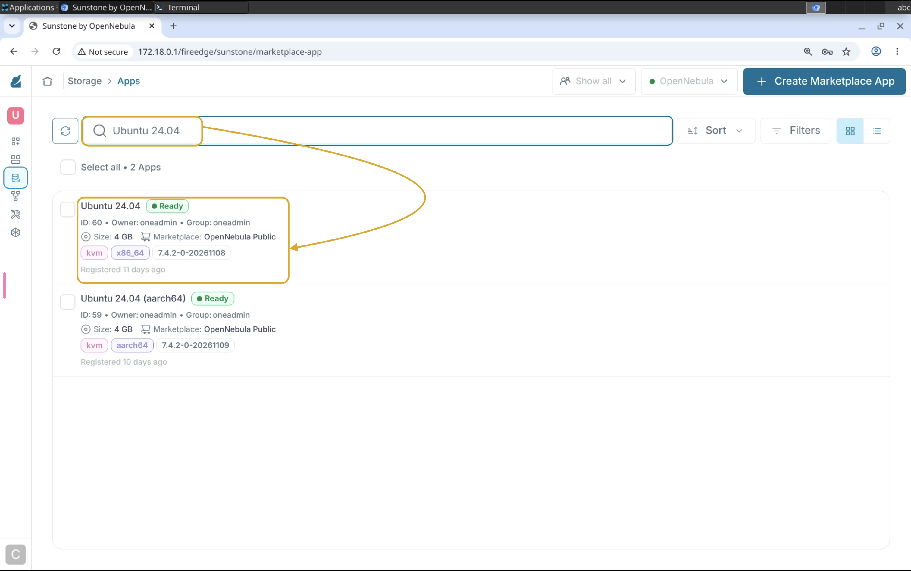

## 4.1.3

Press the **Import** button.

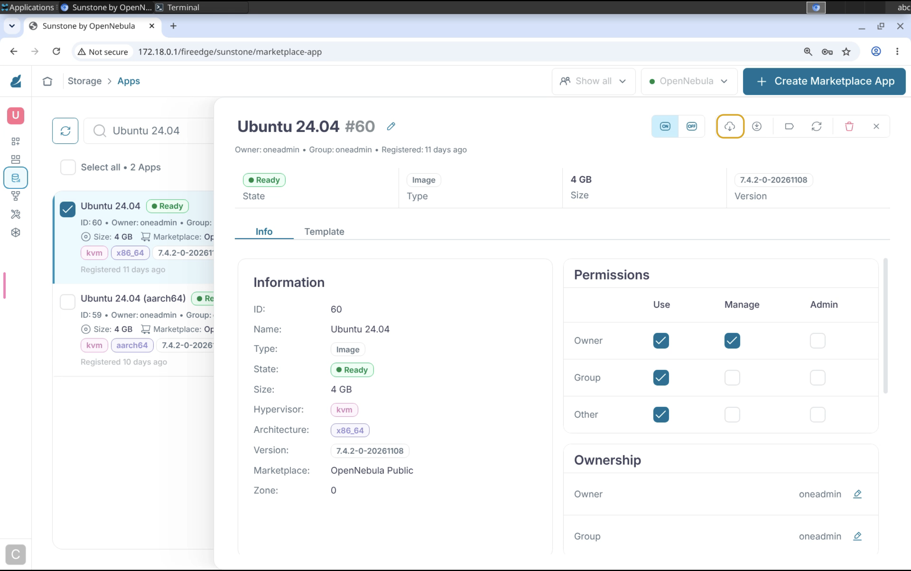

## 4.1.4

Keep both fields as is and proceed to the **Next** page.

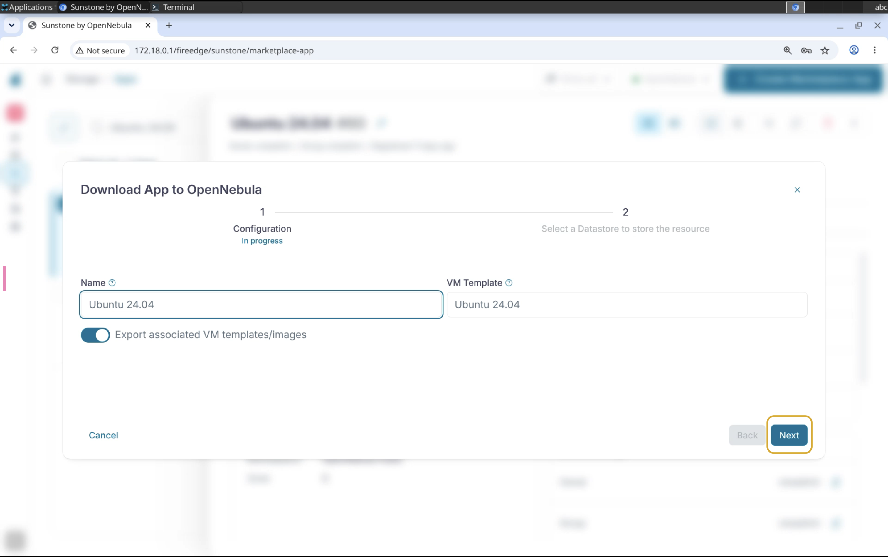

## 4.1.5

Select the **default** datastore and press **Finish**.

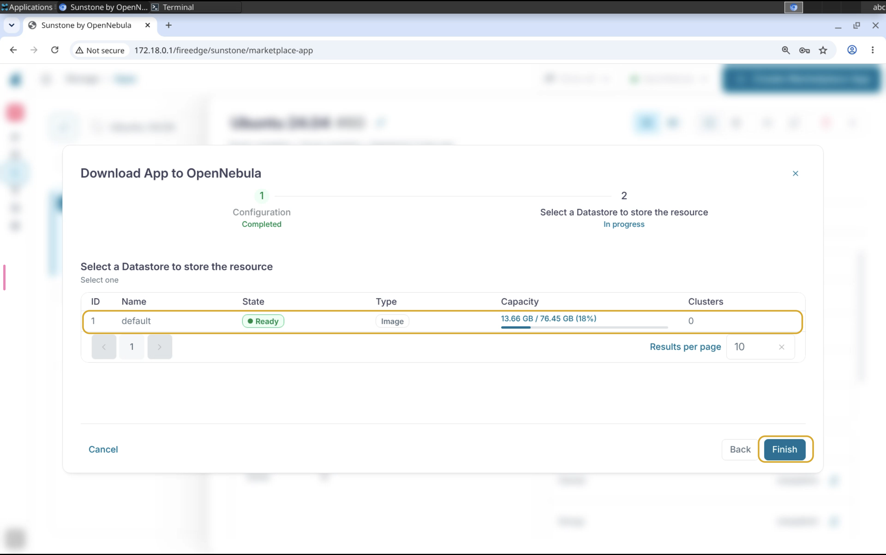

# Change the Persistency setting of both Images

## 4.1.6

Navigate to **Storage - Images**.

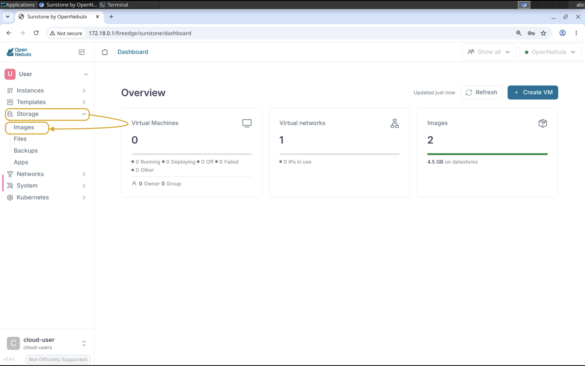

## 4.1.7

Locate and select the **Ubuntu 24.04** image. 

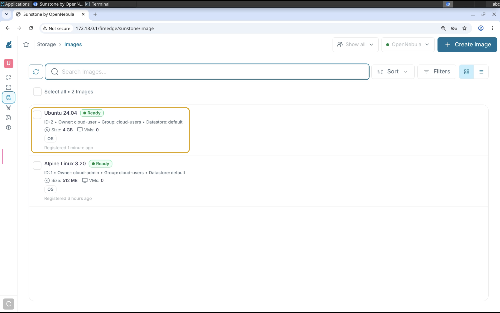

## 4.1.8

Set the image to **Persistent** mode.

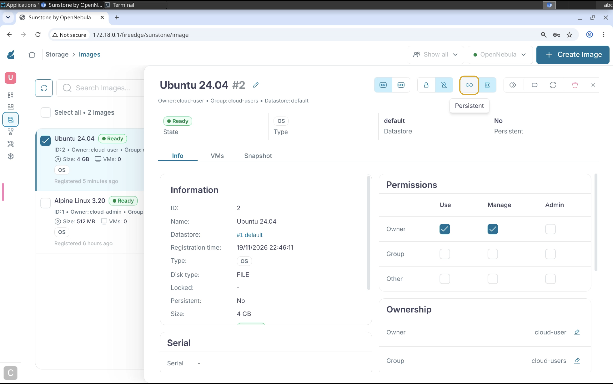

## 4.1.9

Confirm the change.

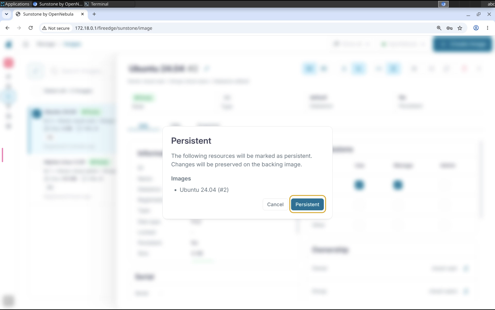

## 4.1.10

Select the **Alpine Linux 3.20**.

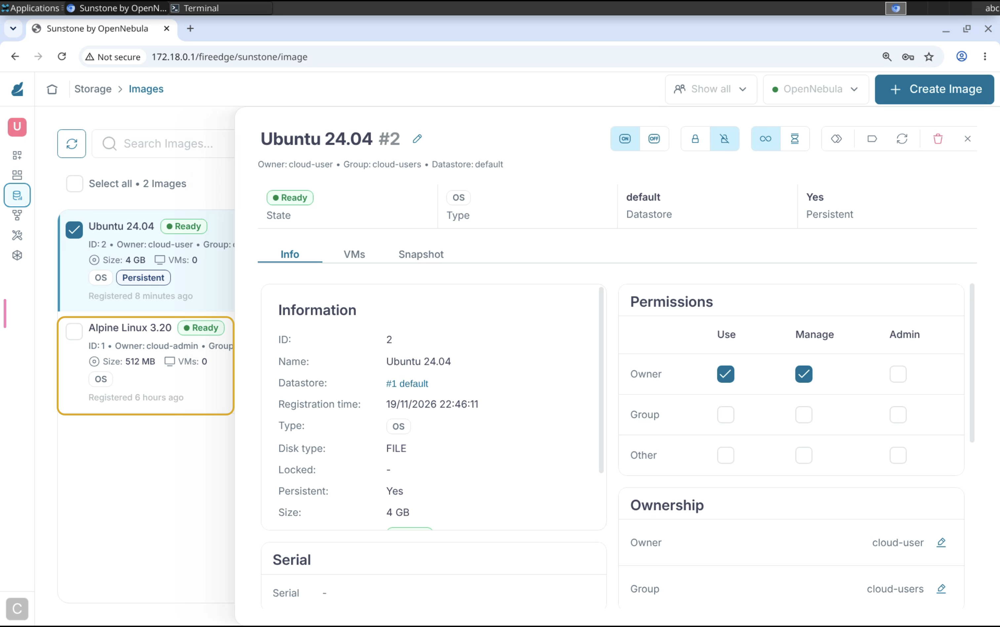

## 4.1.11

Switch the image to **Persistent** mode as well.

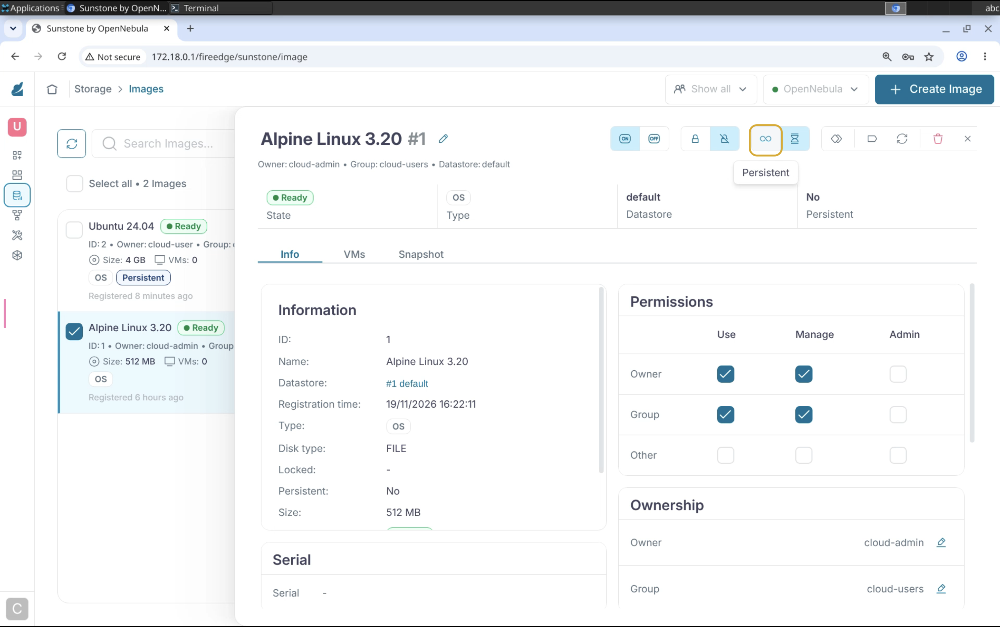

## 4.1.12

Make sure to confirm the intent!

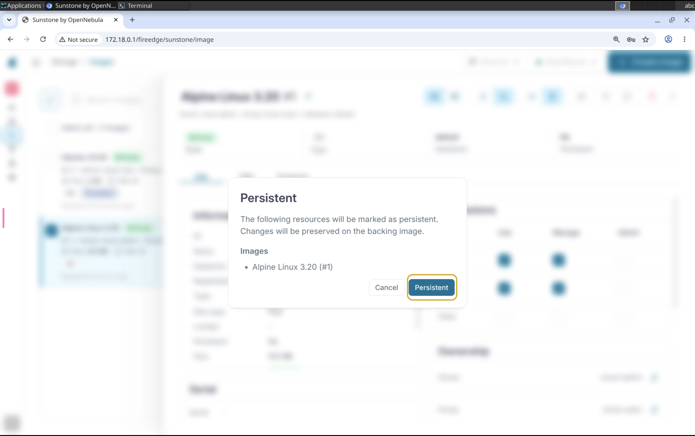

## 4.1.13

You must end up with both images having the **persistent** tag label.

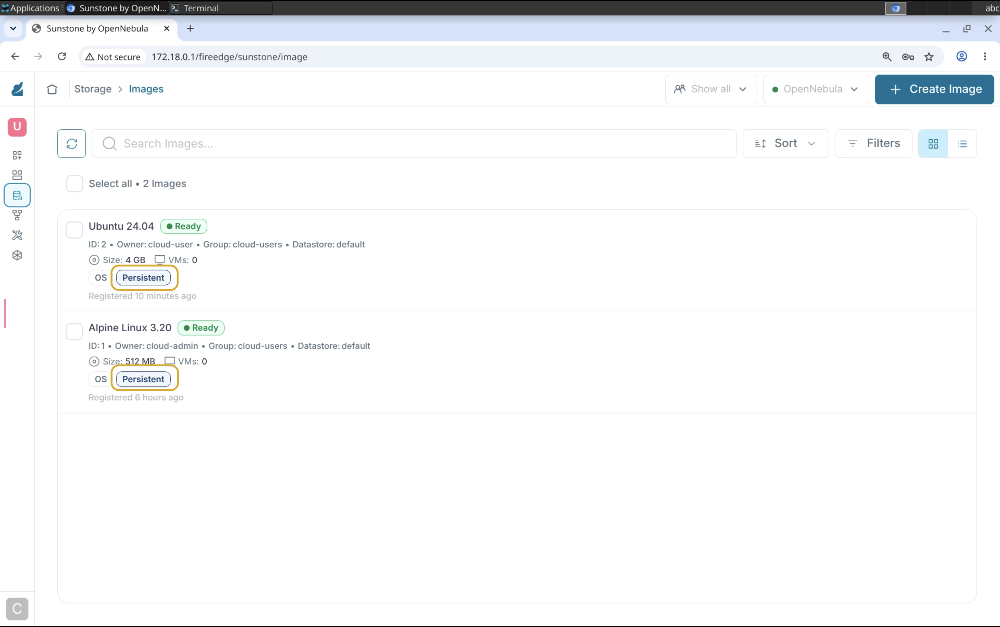

# Congratulations, you've completed the assignment!
{: .no_toc}