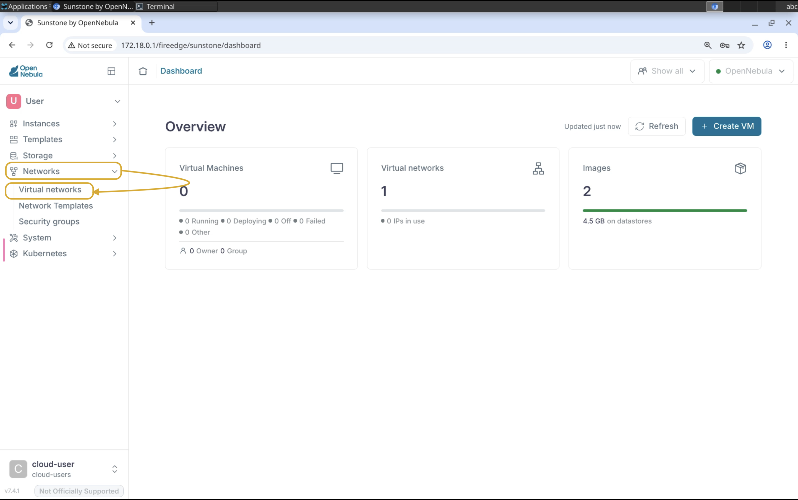
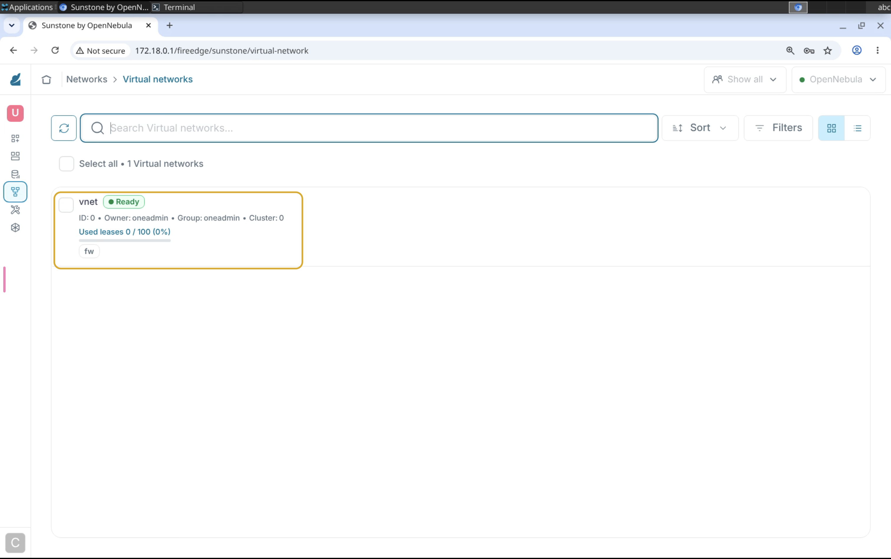
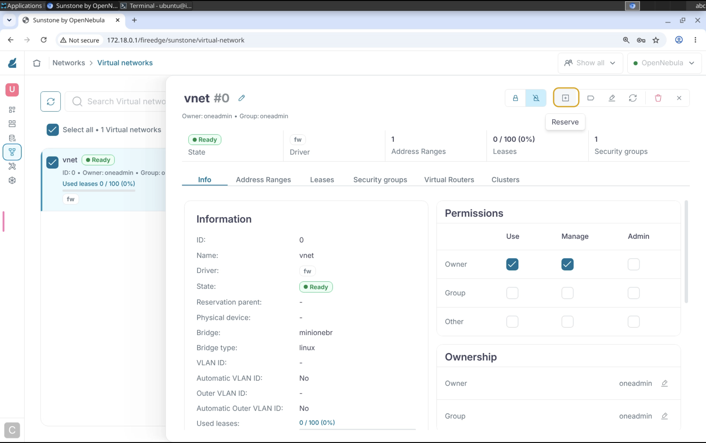
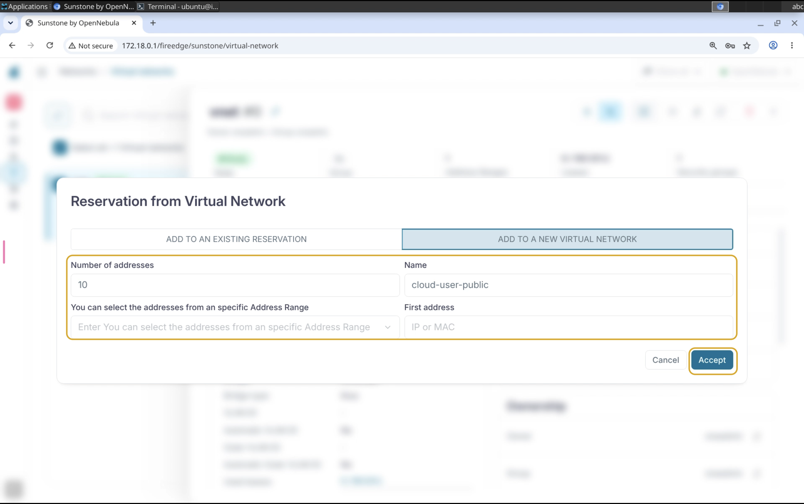
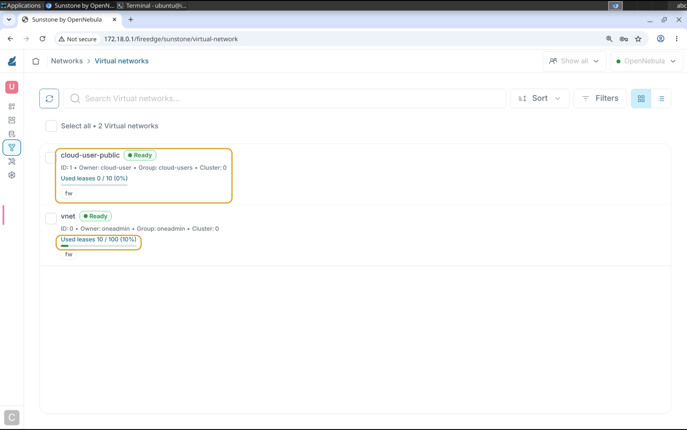
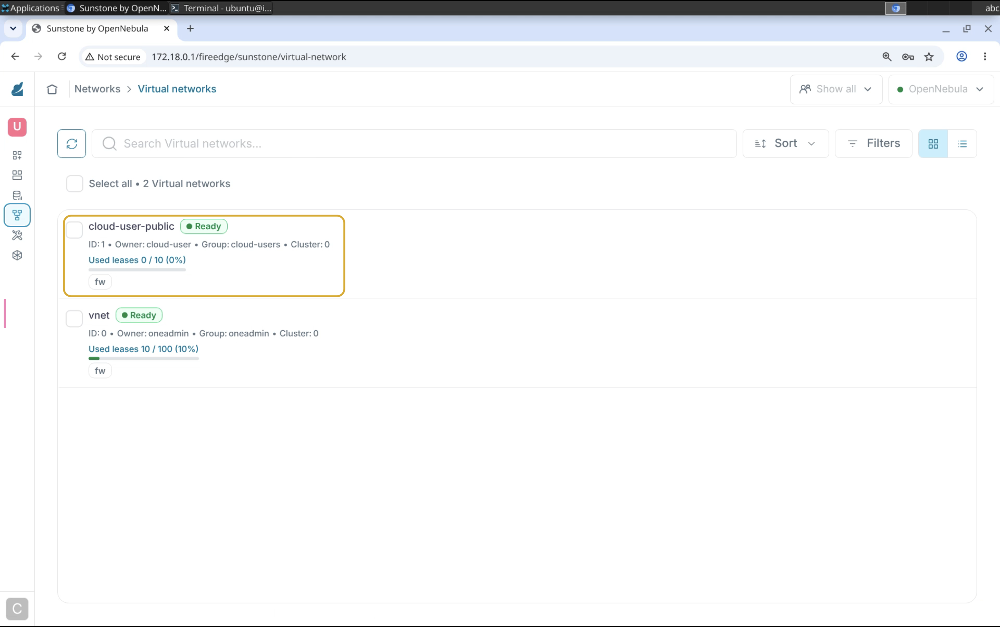
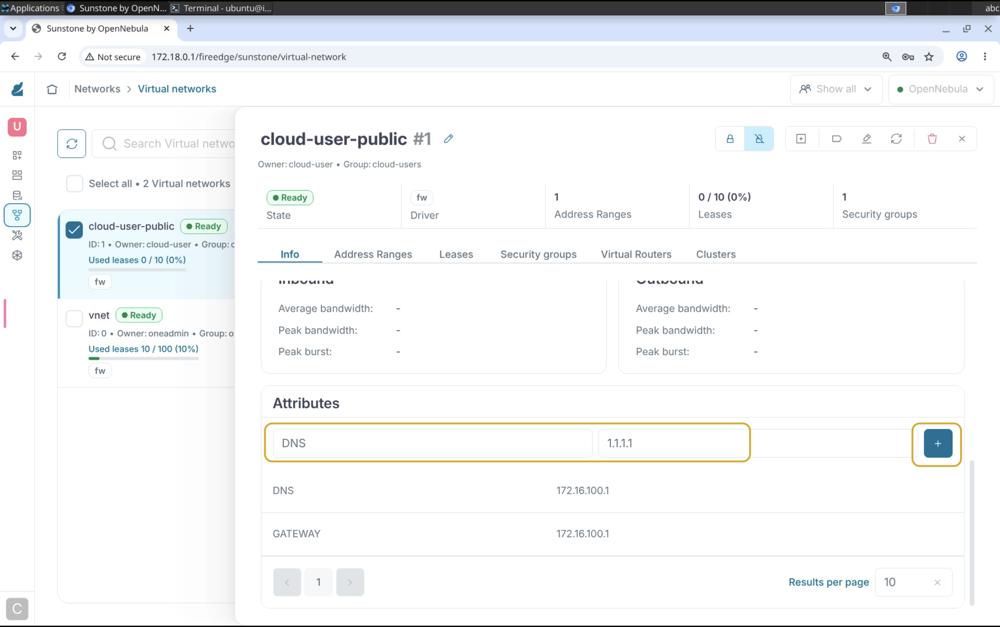
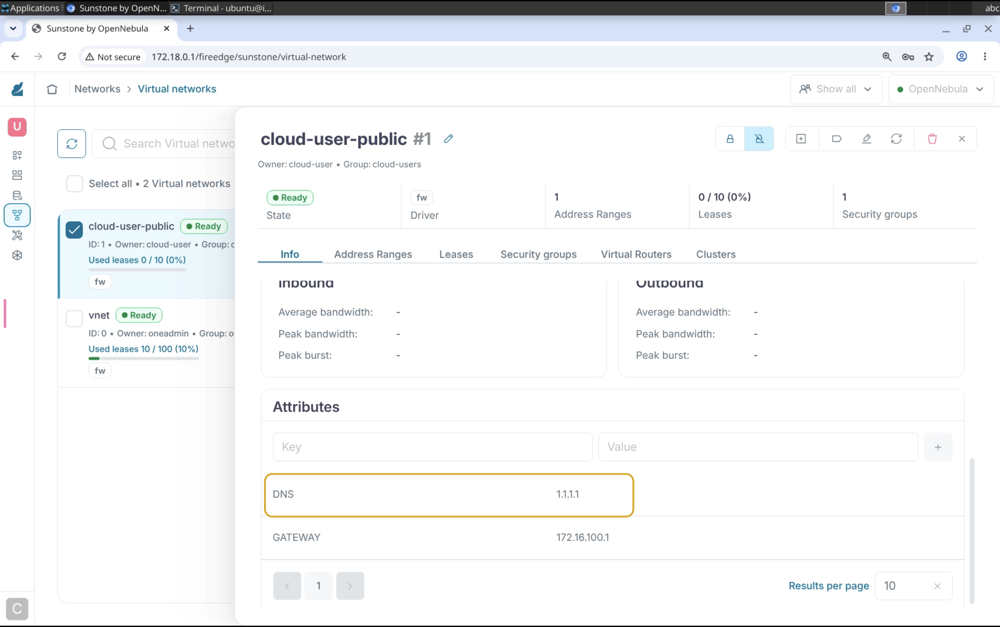

# Module 5 - Lab 1 : Virtual Network Reservation
{: .no_toc}

## Table of Contents
{: .no_toc}

  

    Expand to access the In-page navigation
  

  {: .text-delta }
1. TOC
{:toc}

## Objective(-s):
- Create a Virtual Network Reservation
- Update the DNS attribute

# Create a Virtual Network Reservation

## 5.1.1

Navigate to **Networks -> Virtual Networks**.

## 5.1.2

Locate and select the **vnet** Virtual Network.

## 5.1.3

Press the **Reserve** button. 

## 5.1.4

Set the **Number of addresses** to 10.

And the **Name** field to **cloud-user-public**.

Leave all other fields as is and press the **Accept** button.

## 5.1.5

You might need to refresh the page for the new network to appear in the list.

The **vnet** now must have 10/100 addresses used.

# Update the DNS attribute

## 5.1.6

Select the **cloud-user-public**. 

## 5.1.7

Scroll down to the **Atributes** section and enter the **DNS** as the key and ***1.1.1.1** as the value.

Then press the **+** button to add/update the attribute.

## 5.1.8

Once saved - the DNS key must now be equal to the new value. 

# Congratulations, you've completed the assignment!
{: .no_toc}