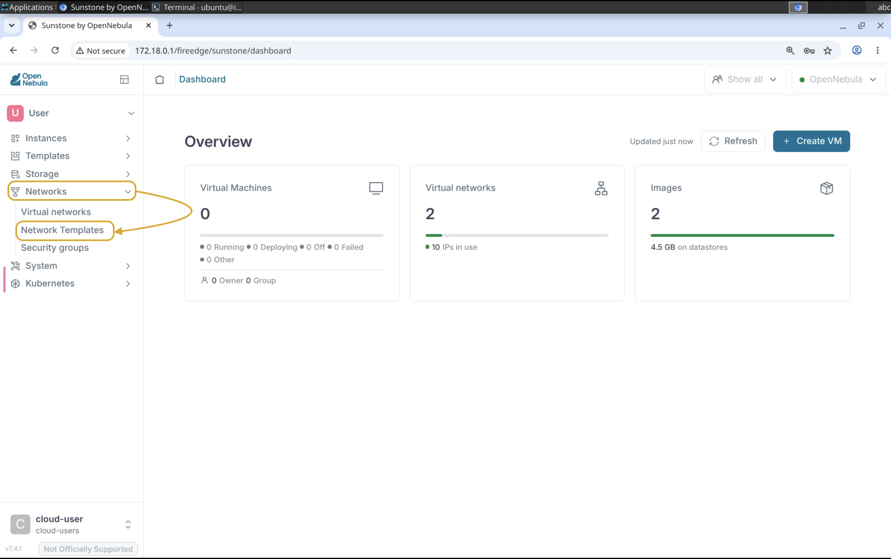
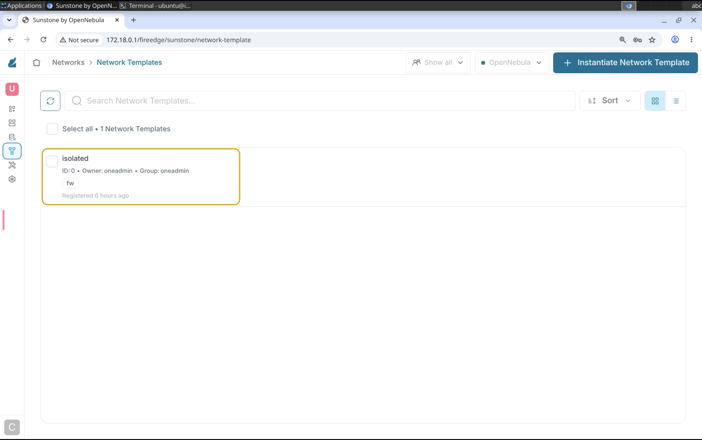
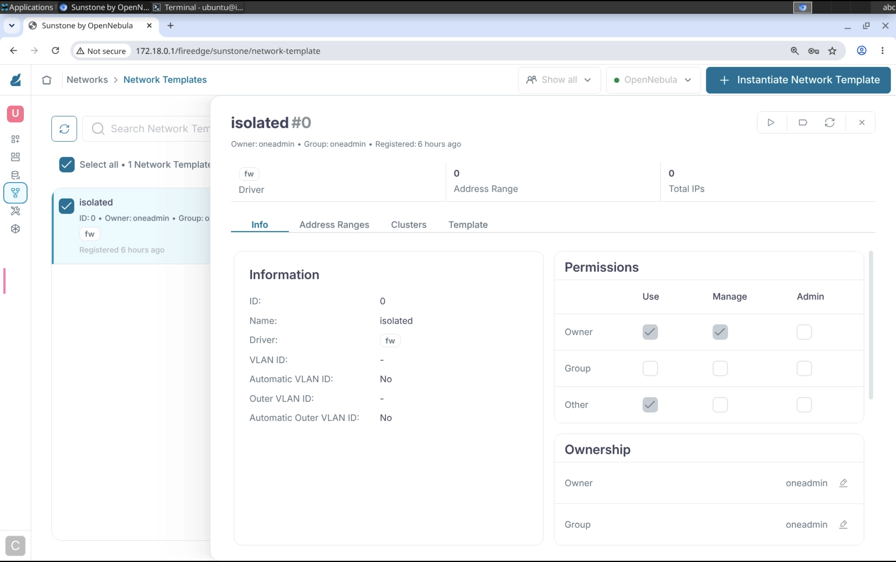
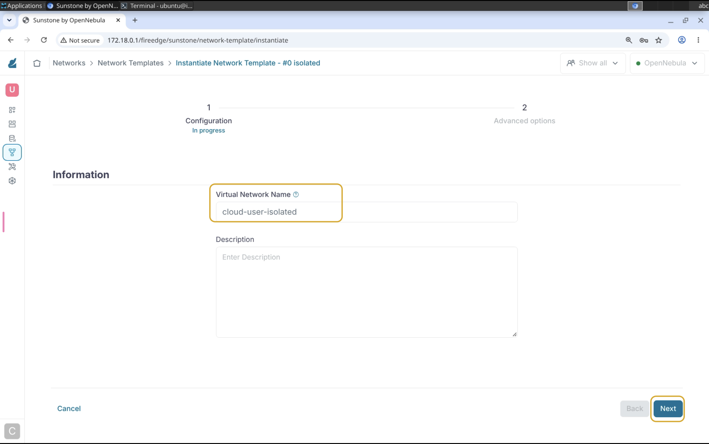
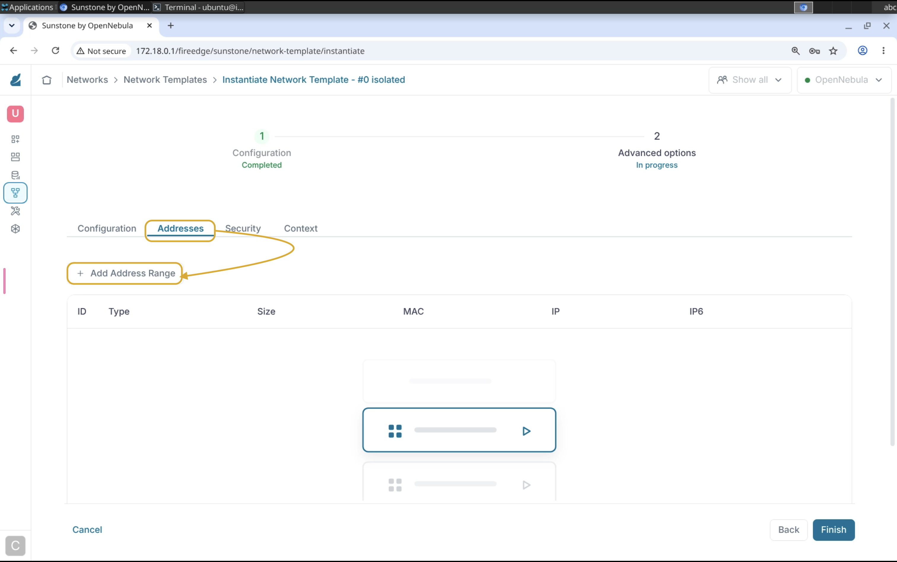
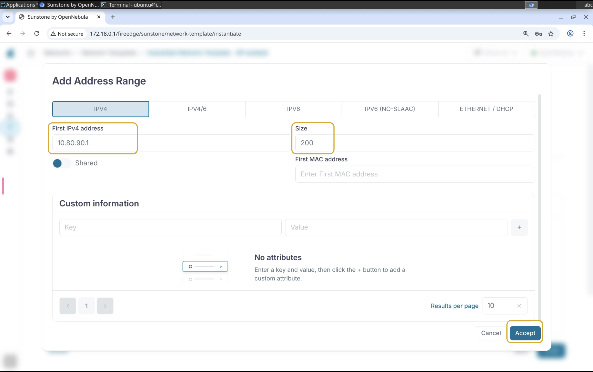
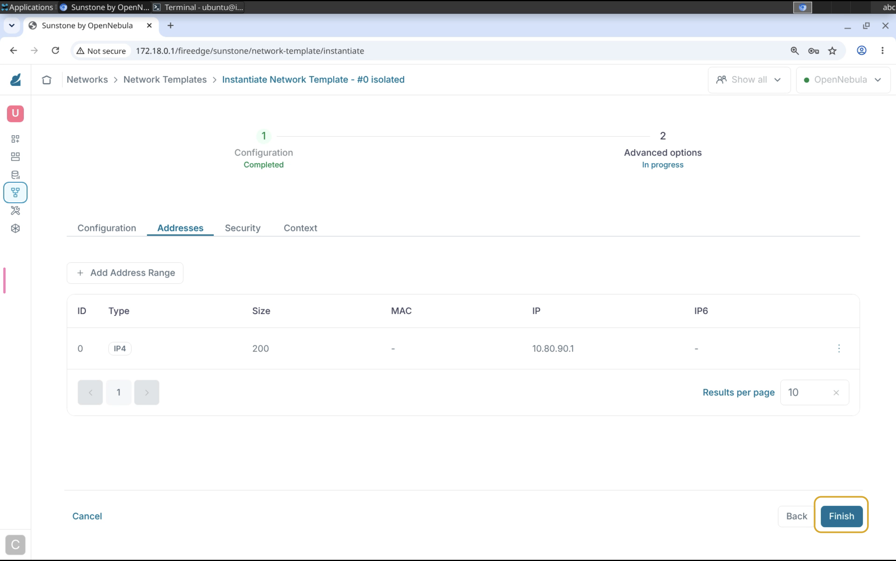
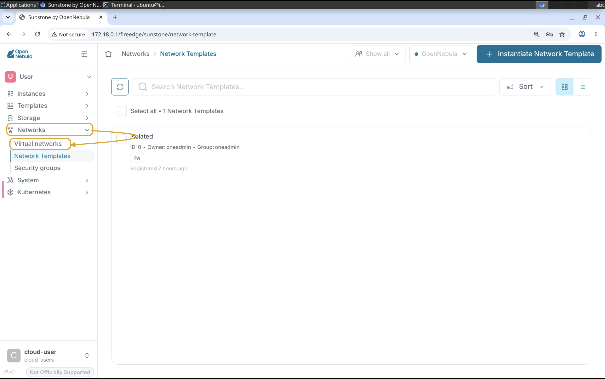
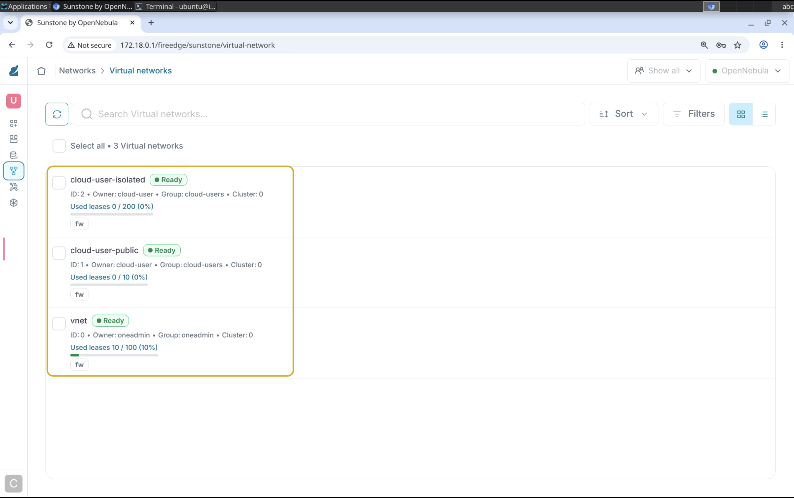

# Module 5 - Lab 2 : Virtual Network Templates
{: .no_toc}

## Table of Contents
{: .no_toc}

  

    Expand to access the In-page navigation
  

  {: .text-delta }
1. TOC
{:toc}

## Objective(-s):
- Instantiate the Virtual Network Template

# Create a Virtual Network Reservation

## 5.1.1

Navigate to **Networks -> Network Templates**.

## 5.1.2

Locate and select the VN Template nmed **isolated**.

## 5.1.3

Press the **Play** button.

## 5.1.4

Name it **cloud-user-isolated** and proceed to the **Next** screen.

## 5.1.5

Switch to the **Addresses** tab and press the **Add Address Range** button. 

## 5.1.6

Set the **First IPv4 address** to **10.80.90.1**. 

Set the **Size** to **200**.

Press the **Accept** button.

## 5.1.7

Keep all other settings as is and press the **Finish** button.

## 5.1.8

Navigate to **Networks -> Virtual Networks**

## 5.1.9

You should end up having three networks, two of them owned by **cloud-user**.

# Congratulations, you've completed the assignment!
{: .no_toc}